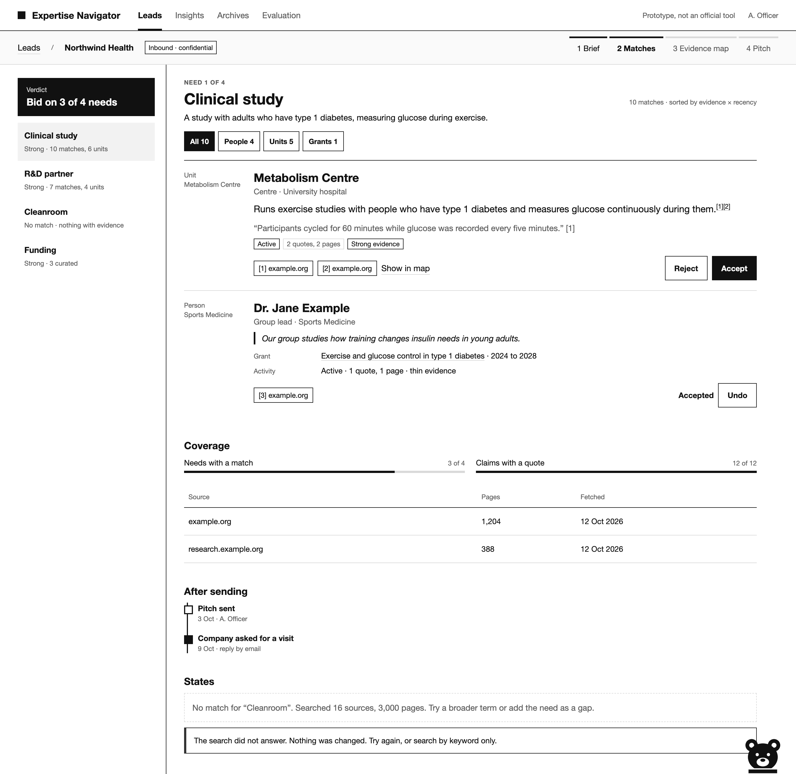

# newspaper style

**news·pa·per style** *(n.)* A way of setting screens and documents like a broadsheet: black type, hairline rules, two columns, every claim sourced. *Coined by Mike Romano, 2026, on seeing mutz.*

    git clone https://github.com/beSaif/newspaper-style ~/.claude/skills/newspaper-style
